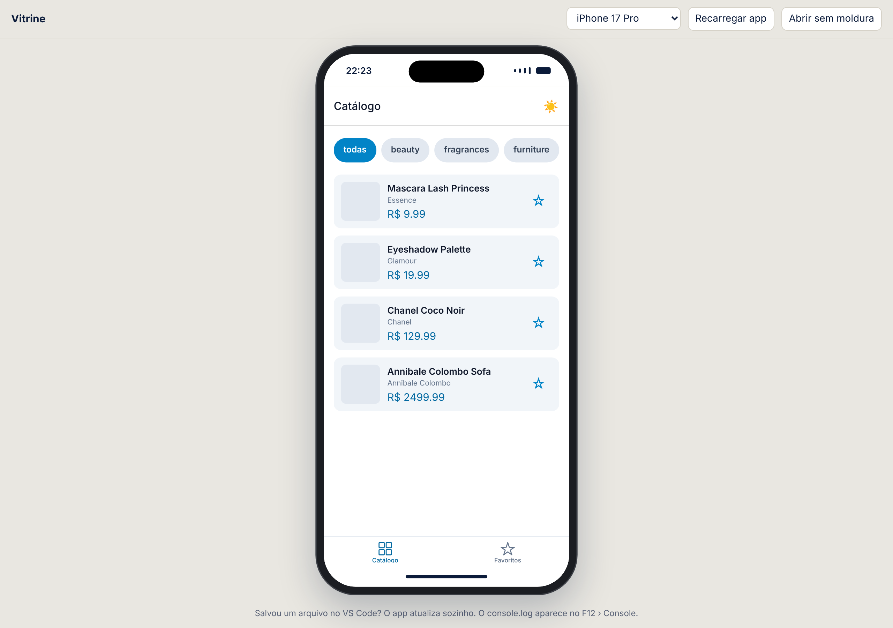

# Vitrine

Catálogo de produtos em React Native, o projeto do semestre da disciplina **Desenvolvimento para Dispositivos Móveis** (prof. Arnaldo, FATEC Araraquara, 2º semestre de 2026).

## Stack

Expo SDK 57, React Native 0.86, React 19.2.3, TypeScript estrito, Expo Router (abas, `typedRoutes`), NativeWind 4 + Tailwind 3.4, React Hook Form + Yup.

## Estrutura

| Caminho | O que é |
| --- | --- |
| `app/(tabs)/` | Abas: catálogo (`index.tsx`) e favoritos |
| `app/(auth)/` | Login e cadastro (aula 07) |
| `app/produto/[id].tsx` | Detalhe do produto |
| `src/components/` | `CardProduto`, `FiltroCategorias`, `BotaoTema`, `CampoTexto` |
| `src/constants/` | Produtos de exemplo e cores do tema |
| `public/simulador.html` | Simulador: o app web dentro de uma moldura de celular |
| `iniciar.cmd` / `iniciar.ps1` | Atalho de um clique que liga o Expo e abre o simulador |
| `src/validacao/` | Esquemas Yup do login e do cadastro |

## Como rodar

### Com simulador de celular no navegador (Windows)

Dê dois cliques em `iniciar.cmd` na pasta do projeto (ou rode `.\iniciar.cmd` no PowerShell). Ele instala as dependências na primeira vez, liga o Expo e abre no navegador o **simulador**: a Vitrine dentro de uma moldura de celular, sem precisar do Expo Go.

- Endereço: http://localhost:8081/simulador.html (dá para trocar o aparelho no topo: iPhone 17 Pro, Pro Max, SE ou Android).
- Salvou um arquivo? O app no simulador atualiza sozinho. O `console.log` aparece no F12 › Console.
- O simulador mostra a versão web do app (`react-native-web`). O QR code continua no terminal para conferir no celular, porque alguns erros só aparecem no aparelho.



### Manualmente

```powershell
npm install
npx expo start -c     # QR code para o Expo Go; tecla w abre no navegador
npm run check         # TypeScript, em outro terminal, depois que o servidor subiu
```

## Sub-projetos da disciplina

Laboratórios que ficam em repositórios próprios, porque o roteiro pede um projeto separado da Vitrine:

| Projeto | Repositório | O que pratica |
| --- | --- | --- |
| Calculadora (aula bônus) | [Felpz016/Calculadora_Mobile](https://github.com/Felpz016/Calculadora_Mobile) | Componente, JSX, props, evento e estado, os mesmos cinco conceitos da Vitrine |
